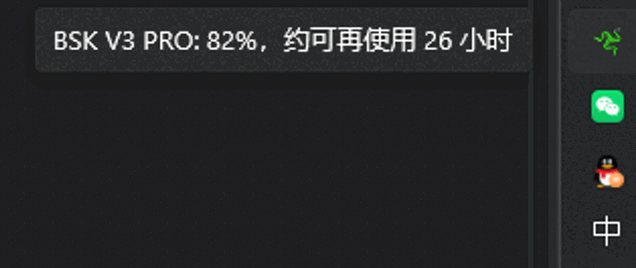
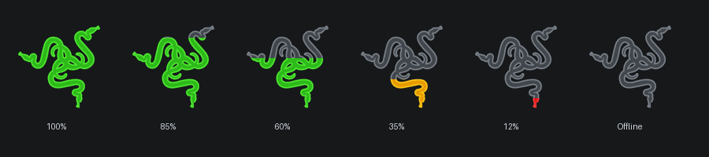

# RazerBatteryTray — 雷蛇无线鼠标状态栏电量显示工具

> 本项目基于 [Tan-TanZi/InphicBatteryTray](https://github.com/Tan-TanZi/InphicBatteryTray) 的轻量级单文件架构衍生开发，专为 **雷蛇（Razer）无线鼠标** 打造任务栏（系统托盘）实时电量与剩余续航显示。

不修改原厂驱动、不注入原厂软件、无需安装庞大的运行时或 SDK——将雷蛇标志性的**三头蛇图标**常驻在 Windows 状态栏中，按当前剩余电量从下往上动态填充，并显示预计可用小时数。

状态栏实机运行效果：



不同电量档位下的三头蛇液位显示：



---

## 核心特性

| 特性 | 说明 |
|------|------|
| **雷蛇三头蛇液位图标** | 状态栏图标采用雷蛇三头蛇轮廓，按电量百分比从下往上双色阶实心填充，在 `16×16` / `24×24` 小尺寸下依然清晰饱满 |
| **动态电量告警配色** | 雷蛇荧光绿 `#50EB32`（>40%）/ 琥珀黄 `#FFC814`（16–40%）/ 警报红 `#FF3C3C`（≤15%）/ 休眠离线暗灰 |
| **充电闪电角标** | 检测到有线连接或充电底座充电时，图标右下角自动叠加高亮黄色闪电标识 `⚡` |
| **剩余续航小时估算** | 悬停提示与详情浮层直观显示 `BSK V3 PRO: 82%，约可再使用 26 小时`（右键菜单支持切换 32h / 90h / 150h 续航基准） |
| **三通道自适应采集** | 同时支持 **蓝牙 (BLE，如 `BSK V3 PRO`)** + **雷云 (Synapse 3/4) 日志无感协同** + **2.4G/有线 HID 直连** |
| **与雷云零冲突共存** | 后台常驻雷云时优先读取雷云日志；HID 直连内置总线忙闲探测（Bus Idle Check）与零权限免驱句柄 |
| **轻量零依赖单文件** | 纯 C# 单文件实现，使用 Windows 自带 `.NET Framework 4.x` 编译器一键生成百 KB 级独立 `.exe` |

---

## 快速开始

### 方式一：直接运行 Release 单文件
1. 下载 `RazerBatteryTray.exe` 并放入固定目录（如 `C:\Tools\RazerBatteryTray\`）
2. 双击运行，任务栏右下角状态栏即会出现三头蛇电量图标
3. 右键图标 → 勾选 **「开机自动启动」**

### 方式二：从源码一键编译
本项目**无需安装任何第三方 SDK 或 Visual Studio**，直接调用 Windows 10 / 11 自带的 `.NET Framework 4.x` 编译器即可编译：

- 双击根目录下的 **`build.bat`**；或在 PowerShell 中运行：
  ```powershell
  powershell -NoProfile -ExecutionPolicy Bypass -File .\build.ps1
  ```

---

## 托盘交互说明

| 操作 | 效果 |
|------|------|
| **鼠标悬停** | 显示 `BSK V3 PRO: 82%，约可再使用 26 小时` |
| **双击图标** | 弹出雷蛇暗黑绿风格非模态详情浮层（不抢游戏焦点，4 秒自动消失，鼠标移入保持） |
| **右键菜单** | 支持 `显示设备详情`、`立即刷新电量`、`数据源模式切换`、`续航时间估算基准切换`、`开机自动启动`、`退出` |

---

## 工作原理（三通道自适应引擎）

1. **通道 A：蓝牙 (BLE) 原生电量属性读取（适配 `BSK V3 PRO` 等蓝牙模式）**
   - 通过 Windows `setupapi.dll` (`SetupDiGetDevicePropertyW`) 读取系统设备树中的蓝牙电池服务属性 `DEVPKEY_Bluetooth_Battery` (`{104EA319-6EE2-4701-BD47-8DDBF425BBE5}, PID 2`)，并通过 `DEVPKEY_Device_ContainerId` 自动关联蓝牙鼠标名称（如巴塞利斯蛇 V3 专业版 `BSK V3 PRO`）。
2. **通道 B：雷云（Razer Synapse 3 / 4）后台日志无感解析（防冲突优先）**
   - 当检测到后台运行雷云时，以 `FileShare.ReadWrite` 只读共享方式解析 `RazerAppEngine\User Data\Logs\background-manager.log`（Synapse 4）或 `Synapse3\Log`（Synapse 3），完全不占用 USB 总线。
3. **通道 C：原生 Razer 90-Byte HID Feature Report 直连（独立运行 & 兜底）**
   - 免驱枚举 `VID = 0x1532` 控制接口，以 `desiredAccess = 0` 绕过 Windows `mouclass` 鼠标独占锁，发送 `0x07 0x80`（查询电量）与 `0x07 0x84`（查询充电状态），支持巴塞利斯蛇 V3 Pro、毒蝰 V2/V3 Pro、炼狱蝰蛇 V2/V3 Pro、眼镜蛇 Pro、那伽梵蛇 V2 Pro 等主流雷蛇无线鼠标。

---

## 致谢

- [**Tan-TanZi/InphicBatteryTray**](https://github.com/Tan-TanZi/InphicBatteryTray) — 本项目的基础框架来源。原项目设计了极简优雅的零依赖 C# 单文件架构、GDI+ 托盘液位渲染管线与无焦点详情浮层交互，本项目在此基础上重写了雷蛇三通道电量采集引擎与三头蛇图标渲染逻辑。
- [**openrazer/openrazer**](https://github.com/openrazer/openrazer) — 提供了雷蛇 90-Byte USB HID 协议命令格式的开源参考。

---

## 免责声明

1. 本项目是**非官方的开源社区工具**，与雷蛇（Razer Inc.）官方没有任何隶属、赞助或合作关系。
2. 项目中涉及的 Razer™ 名称及三头蛇徽标均为 Razer Inc. 的商标或注册商标，在此仅用于标识所适配的硬件设备。
3. 本工具为纯只读属性/状态查询工具，不修改设备固件、不写入硬件配置、不联网且无任何遥测。使用风险自负。

---

## License

基于 [MIT License](LICENSE) 开源。
